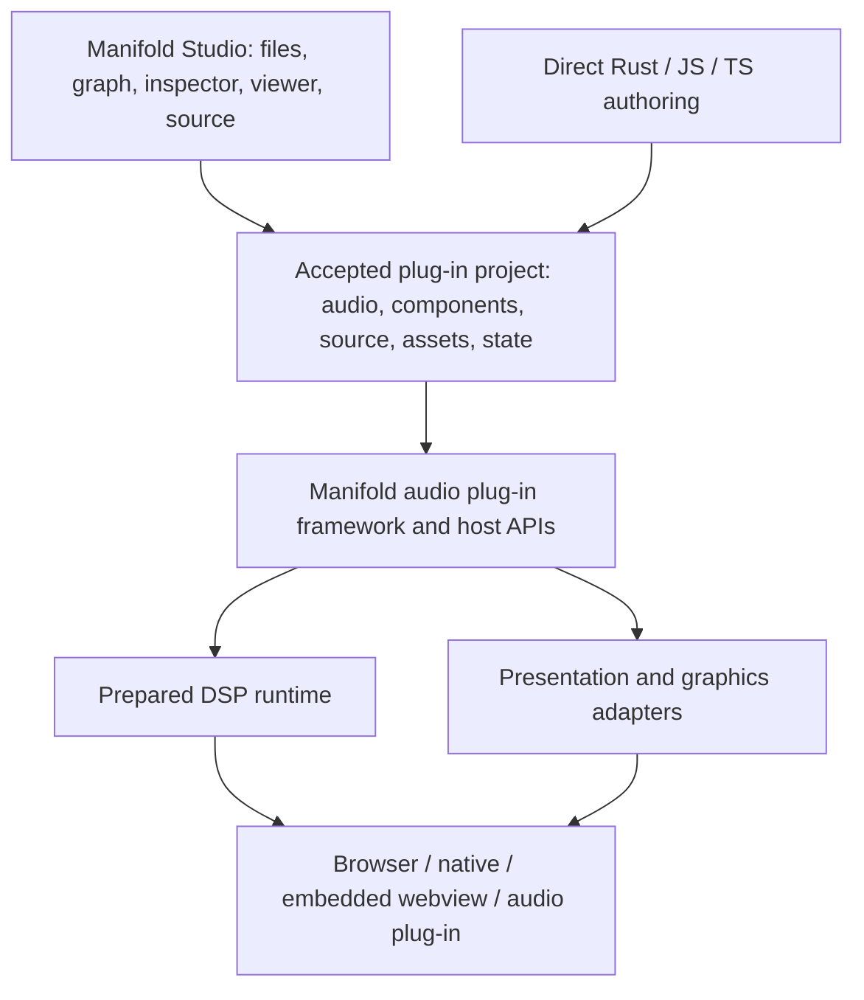

# Manifold Studio: product boundary and architecture review

11 October 2026. Product decisions below come from Lucas's direction in this
session. Implementation recommendations are proposals for the next slice, not
claims of delivered support. Read alongside [issue #2](https://github.com/ShamanicArts/manifold/issues/2),
which requests architectural review before major implementation.

Step 1 is now implemented: see the [product separation delivery ledger](studio-product-separation.md)
for behavior, ownership and validation. Later component/schema proposals remain
open. Lucas requested concrete visual mocks for joint review before implementing
the Studio layout redesign.

Lucas's subsequent [project browser and docking direction](studio-workspace-design.md)
supersedes the provisional source/files pane arrangement below. It includes an
interactive review mock, explicit presenter sizing rules and the project-loading
follow-up. The accepted layout and first custom web-surface slice are now recorded
in [workspace delivery](studio-workspace-delivery.md) and
[component authoring](studio-component-authoring.md). The deeper object/rule
composition described below remains future work.

Reviewed Manifold parent revision `f9c7425d` on `nacre-live-spectral-device`,
not an assumed merge to `main`. Warmap inspection was read-only in
`/home/shamanic/dev/warmap/Workspaces/renderer-experiment-20261007`.

## Settled product boundary

**Manifold Studio is the primary Manifold v2 product.** Studio owns the files and
asset-upload workflow, visual node-and-wire workspace, inspector, viewer,
source editing and authoring tools. It must be useful independently of Nacre or
another example. The visual graph workspace is the actual shared editing canvas;
it is not the name of the DSP execution graph or a second graphics-only editor.

**Manifold remains an audio plug-in library/framework.** It supplies project
contracts, component definitions, execution, host integration and reusable
authoring APIs. An author may build against it without Studio. Studio is a
client of those APIs.

Lucas explicitly clarified that visual-only projects are not a supported product
category. A plug-in may simply retain a valid default audio path without adding
custom processing. Visual and mathematical components expand plug-in authoring;
they do not require an audio-free project model or a general graphics application
platform. The existing audio contract remains the foundation.

**Nacre and other authored products own their content and behavior.** Work driven
by Nacre that enables general authoring belongs to Studio/framework. Both core
devices and project/custom devices must be supported. Origin in Nacre does not
automatically make a device core, or make a general editor feature Nacre-specific.

Authors may use their chosen graphics library/framework or author graphics with
Manifold's own facilities. Delivery can be web, embedded webview or native as the
package and host support. Choice of graphics implementation is distinct from
choice of authoring language and distribution target.



## What Nacre has already contributed

These capabilities already live in shared code, even where their reports and
test fixtures sit under a Nacre directory. Preserve that ownership; moving all
files into new packages is not necessary to establish it.

| Owner | Existing capability or content | Disposition |
| --- | --- | --- |
| Studio | Shared egui graph, inspector, palette, node controls, pan/zoom, layout groups, files, source and viewer integration | General product features. Use Nacre as one regression fixture. |
| Manifold framework | Accepted revisions, public graph operations, parameter paths, source-backed edits, portable state, prepared DSP publication, presentation lifecycle and bindings | Shared contracts usable by Studio and standalone clients. |
| Manifold component library | Phase vocoder, filters, waveshaping, granulation, crossfades, gain and other public primitives | Already reusable; Nacre composes them. |
| Nacre project | Spectral routing, macro choices, Prism Bend composition, Chladni scene, cabinet/relic artwork, crystal hand and shell-creature behavior | Keep project-owned initially; promotion is a separate design decision. |
| Candidate shared components | Field-particle visualization, mesh interaction and telemetry mappings extracted from Nacre | Evaluate individually after defining ports, dependencies, lifecycle and a second use case. |

Prism Bend is an authored filter/shaper module in the saved Nacre project. It
does not require a new core DSP primitive. A portable reusable library module
is a useful middle ground between project-local and built-in core.

The existing spectral/particle face is mostly one imperative Three.js module.
Its controls address accepted parameter paths and its particles consume output
analysis; the scene does not generate or schedule the audio. Keep that working
face as a compatibility case while exposing smaller components deliberately.

## Current seams and the smallest repairs

| Evidence | Consequence | Proposed change |
| --- | --- | --- |
| [Browser entry](../../web/src/app.js) and [host client](../../web/src/filter.js) special-case `ui-nacre` and its dated project URL | Studio bootstrap knows a project's identity and storage path | Move example launch metadata to an example registry; preserve existing links and drafts. |
| [Studio document](../../web/index.html) links Studio to Orbit; the host replaces product identity with the selected example | Studio presents as a collection of instrument pages | Keep Studio identity and opened-project identity separate; make examples explicit templates. |
| [Shared graph UI](../../crates/manifold-app/src/studio.rs) says "Audio graph"; [creator client](../../web/src/authoring/creator-workspace.js) builds its graph from `signal.nodes` | The canvas is reusable but its input model is audio-specific | Name the surface Graph; adapt it to component descriptors after extending the accepted document. A label change alone is insufficient. |
| [GraphWorkspace](../../packages/manifold-author/index.js) creates audio I/O, restricts root fields and validates audio output | Audio I/O is appropriate; non-DSP components still need a persisted contract | Keep the valid audio graph, provide a minimal default audio path, and extend the accepted document for additional component domains. |
| [Presentation editor](../../web/src/authoring/custom-view-editor.js) assumes tone gestures and Three.js/WebGL2 in help/status; browser/native hosts duplicate dependency maps | A generic surface carries example and backend assumptions | Keep help project-defined or generic; centralize host dependency capabilities without claiming arbitrary imports already work. |
| [Web view contract](../../packages/manifold-author/web-view.js) packages one web module | Arbitrary visual code can run, but its pieces are not independently wireable nodes | Preserve it as a custom-surface implementation and add composable visual component definitions. |
| [Studio modules](../../packages/manifold-author/studio-graph.js) expand 1–32 DSP primitives with declared interfaces | This is useful reuse, but not arbitrary nested components or selection-to-component packaging | Reuse interface/path handling; add dependency closure, nesting and cycle validation in a later bounded slice. |

The identity/routing repairs are small. A real multidomain component graph and
graphics capability model are substantive features. Treating those as a rename
would leave the same architectural constraint underneath.

## Authored objects and inspectable rules

Lucas clarified this product requirement on 11 October 2026 after reviewing the
Output Probe: something declared by an agent, a script or the graphical authoring
tools should be exposable as an addressable project object. Authors must be able
to find it in the tree and graph, connect downstream operations, and understand
what rules produce its current result. Showing only an opaque final display is
insufficient for the intended visual authoring workflow.

An exposed object has stable identity, a declared interface and a link to its
definition/source. Script and canvas declarations participate in the same
accepted project model and public operations; they are not separately editable
copies. A generated runtime renderer handle is not the object's saved identity.
An object may expose a shape, field, resource or composite result, subject to
the types and capabilities its implementation actually supports.

Rules may be downstream nodes or exposed operations within a component. The
graph should represent as much meaningful composition as the author exposes;
the inspector should explain the selected result's incoming dependencies,
applied operations and their order, parameter values and bindings, and source.
For branches, show the actual dependency relationships rather than inventing one
linear modifier stack. Exposed editable values and connections must affect the
running result through the same accepted edits available to agents and scripts.

The desired first demonstration is an explicitly declared shape or field feeding
repetition, then deformation, then a compatible renderer. Audio analysis can
drive an exposed deformation parameter while the ordinary audio path continues.
These are proposed node roles, not names of shipped APIs. Selecting any stage
should make clear what it receives, what rule it applies and what it produces.

Authors can keep a complex algorithm encapsulated in custom source or expose
its internal composition for deeper inspection. The contract does not require
automatic reconstruction of arbitrary imperative code into graph nodes. It does
require declared objects and rules to remain discoverable and manipulable across
authoring surfaces. Renderer-specific objects retain explicit compatibility
limits; making an object visible in Studio does not make it portable to every
graphics library or target.

Acceptance for the next object/rule slice:

1. Declare an object in script and locate the same identity in the tree and graph.
2. Add a downstream rule in the graph, edit an exposed value in the inspector,
   and observe the expected output change. Show the actual source, bindings and
   dependency chain, including any intentionally encapsulated implementation.
3. Perform equivalent edits through public agent/script operations. Unrelated
   source edits preserve graph-authored changes; conflicting edits produce an
   explicit conflict without silently discarding either author's work.
4. Save/reopen and undo/redo retain object identity, rule connections, values,
   definitions and source. Verify the same supported chain in browser/Wasm and
   standalone; reject unsupported connections before acceptance.

This extends the existing accepted-document/revision model. It does not introduce
a separate visual project type, a second audio path or renderer work in the audio
callback. The current web-surface implementation only accepts output analysis
and renders independent displays; it does not yet implement this chain.

### From a selected node to its authored code

Lucas further clarified that the Explorer must reveal relationships between
objects, their declarations, attached scripts, reusable definitions and files.
With the source editor in use, selecting Level history should make its own logic
readily accessible instead of leaving the author to discover why `project.mjs`
is still open. A node may have several associated scripts or share a source file
with other nodes; do not assume one file per node. Navigation must preserve dirty
drafts and keep source viewing optional in the workspace.

Distinguish three authoring relationships in that navigation:

- **Declaration:** where this instance is constructed, configured and connected.
  Gain's declaration may remain part of `project.mjs`; navigate to the relevant
  code rather than merely opening the whole project entry.
- **Definition:** the reusable implementation, such as Level meter's rendering
  and measurement-display logic. Make the scope of edits clear when multiple
  instances share it. A built-in DSP primitive must be identified honestly as a
  compiled implementation, not presented as an editable JavaScript kernel.
- **Attached behaviour:** authored logic governing an instance or its bindings,
  interaction and control. Its association and scope should be visible, whether
  written by a person or agent. Downstream nodes remain another way to compose
  behaviour; they do not replace access to a node's own logic. Script attachment
  roles and execution semantics still need design; arbitrary scripts must not
  enter the audio callback.

The first custom-visual slice has a definition-source button, but Explorer
selection only changes the inspector; audio-node declarations have no equivalent
navigation. That is a real discoverability/authoring gap. Repairing it is part of
the next tooling milestone, before growing the visual-node catalogue.

Use Nacre as the subsequent substantive authoring check once these foundations
work. Its existing project source declares the spectral DSP chain; its
`ui-nacre-view.mjs` combines field/shader rendering, analysis smoothing and
parameter mappings, asset-backed hand/eye/shell objects, gesture handling and
control-panel bindings. These are candidates for inspectable nodes with attached
scripts or reusable composites, not a requirement to turn every statement into
a node. Inventory what is shared Studio machinery versus Nacre-specific logic,
then prove a representative connected portion can be authored and understood
through Studio. This is not authorization to replace its artwork or redesign its
presentation while establishing the tooling.

## Recommended architecture, for review

**One accepted document, specialised execution.** Extend the authoring layer,
not Rust DSP `SignalKind` with renderer objects. Component instances have stable
identities and definitions; connections carry explicit types and rate/lifecycle
semantics. The document owns source, assets, public parameters and authored
layout. Its DSP portion lowers into the existing graph compiler. Presentation
and resource preparation have separate schedules and prepared state.

This is preferable to a parallel visual graph with its own save/undo/revision
authority. Keep the existing audio contract, stable IDs and compilation path;
do not maintain two independently editable copies of its DSP nodes. A new
plug-in template can begin with an ordinary input-to-output connection. No
audio-free schema or optional-audio execution model is needed. Exact additive
schema/version and mixed-domain transaction publication remain open.

**One definition contract for core and custom components.** Proposed definition
metadata covers type/version, named ports, parameters, source entry points,
implementation targets, dependencies/assets and lifecycle/state policy. An
instance ID is distinct from its definition ID. The palette discovers project,
installed-library and built-in definitions through this contract. Custom code
does not need promotion to core before it can appear on the canvas.

**Typed transport.** Keep audio-rate streams, events, parameter commands,
bounded analysis snapshots and resource references distinct. An audio-analysis
adapter exposes timestamped snapshots to visuals; render frame drops never
alter audio timing. A field sampler becomes audio-capable only through a
bounded prepared evaluator, with its own smoothing/aliasing policy. Arbitrary
JS, resource loading and GPU execution do not enter the audio callback.

**Two graphics integration paths.** Compatible components contribute geometry,
materials, scene objects or passes to an adapter-owned renderer. That adapter
owns cameras, draw order, GPU allocation and disposal. A custom-surface component
may instead own a Canvas, p5, Three.js, another web library, or a native renderer.
It still declares inputs, outputs, target support and lifecycle. This preserves
framework freedom without pretending all libraries share a scene-object ABI.

Use portable data/resources where implementations can agree on meaning. Keep
backend-specific object handles explicitly typed and scoped to their owner.
Cross-backend bridges transfer supported geometry, images or textures with
declared synchronization and copying costs; unsupported connections fail before
acceptance. A Three.js object cannot simply become a wgpu object through a wire.

**Native authoring and delivery are separate capabilities.** Rust-authored
components can provide native/Wasm artifacts; JS/TS components can use browser
or embedded-webview hosts. A custom web dependency does not automatically gain
a native renderer. Manifold's own visual vocabulary could have a shared Rust
preparation layer with native wgpu and browser adapters. That is a recommended
direction to prove, not a requirement that every custom author adopt wgpu.
Show missing target capabilities at component selection and export.

**Preserve edits across code and canvas.** Extend the existing accepted-revision
commands and source-backed graph edits. Initially require explicit component
declarations and stable IDs; preserve unrestricted custom code inside definitions.
For source regeneration, recommend comparing its base revision, the accepted
document and the proposed result. An unrelated script edit preserves a human's
inserted node. Deleting or changing something modified on both sides requires an
explicit conflict result and leaves the accepted project running. Do not promise
lossless round-tripping of arbitrary imperative JS or Rust code.

**Composites package real dependencies.** A saved selection includes its graph,
external ports, exposed controls, definitions, source, assets and versions.
Nested paths map deterministically to stable instance identity. Reject recursive
definition dependencies; describe runtime feedback/delay rules separately from
definition recursion. A visual layout group is not a reusable composite.

## Studio redesign brief

The main action is to add, connect, inspect and modify a component while seeing
its result. The Studio remains recognisable when switching from Nacre to another
plug-in or creating a new project with the default audio path. Use the established neutral
charcoal shell, restrained blue selection and existing filled control style.

```text
Manifold Studio   /   Project name        Open · Save · Export     Run / Audio
┌──────────────┬─────────────────────────────────────┬─────────────────────┐
│ Files        │ Viewer: chosen output or face       │ Inspector           │
│ Assets       │                                     │ Selected component  │
│ Components   ├─────────────────────────────────────┤ Ports · controls    │
│              │ Graph: one node-and-wire workspace  │ Source · resources  │
│ + / Upload   │ audio, resources, maths and visuals  │                     │
├──────────────┴─────────────────────────────────────┴─────────────────────┤
│ Source / Activity                    accepted changes, drafts, problems │
└────────────────────────────────────────────────────────────────────────┘
```

- Files, Assets and Components are views of the current project's resources.
  Upload creates a project asset with an explicit reference; replacement reports
  affected consumers. Component search includes core, libraries and local code.
- Graph is the primary authoring space. Existing pan/zoom, named ports, node
  controls and groups remain. Port compatibility is visible during wiring;
  invalid connections explain the specific mismatch. Domain filters change
  visibility, not project identity or execution.
- Viewer follows selection by default, with a pin to keep a chosen output in
  view. Projects can expose several outputs. Fit/navigation belongs to preview
  state; authoring a camera or interaction changes the project explicitly.
- Inspector follows the same selection as Graph, Files and Source. It shows
  public controls first, with ports, implementation and dependencies available
  as needed. Opening component source does not replace the whole project source.
- Graph, Source and Perform layouts resize/show the same panes. Perform gives
  the authored presentation room; it does not export Studio chrome with it.
  Studio pane preferences are local, separate from saved node positions and
  authored control placement.
- On narrow screens, Graph/Viewer/Source become primary tabs with contextual
  inspector and files drawers. Preserve selection and unsaved drafts across
  layout changes. Independent scroll/zoom stays local to each surface.
- New project: retain a valid default audio path; offer Add component, Open and
  an example chooser. Loading:
  retain the last accepted output. Rejected edit: mark the affected component
  and retain the draft. Missing backend/dependency: identify the target and
  dependency; do not silently substitute a different authored visual result.
- Keyboard selection/wiring alternatives, accessible control names, non-color
  port cues and reduced motion are acceptance requirements. Show agent changes
  in shared activity and undo, using the same commands as human edits.

This is a proposed interaction design, not a screenshot of implemented support.

## Warmap: useful machinery and limits

The inspected workspace has a useful split between portable presentation
descriptions, prepared packets and backend resources:

- [`presentation.rs`](/home/shamanic/dev/warmap/Workspaces/renderer-experiment-20261007/rust/warmap_asset_render_core/src/presentation.rs)
  defines asset recipes, catalogues, provider identity, bindings, required
  capabilities and explicit substitutions without engine objects/pixel buffers.
- [`mesh_packet.rs`](/home/shamanic/dev/warmap/Workspaces/renderer-experiment-20261007/rust/warmap_asset_render_core/src/presentation/mesh_packet.rs)
  retains resource/geometry IDs, authored transforms and resource retirement.
  [`object_scene_packet.rs`](/home/shamanic/dev/warmap/Workspaces/renderer-experiment-20261007/rust/warmap_asset_render_core/src/presentation/object_scene_packet.rs)
  makes scene preparation, resource dependencies and render ownership explicit.
- [`overworld-presentation.ts`](/home/shamanic/dev/warmap/Workspaces/renderer-experiment-20261007/artifacts/web/src/runtime/overworld-presentation.ts)
  still orchestrates preparation around shared Rust compilers. The inspected
  [`native main`](/home/shamanic/dev/warmap/Workspaces/renderer-experiment-20261007/rust/warmap_native/src/main.rs)
  loads a campaign and reports terrain; a wgpu dependency in its manifest does
  not establish a finished native presentation host.

Adopt the ownership/preparation pattern, not Warmap's game-specific schema.
Its mesh loader rejects singular transforms. That restriction cannot become
Manifold's general transform rule: the Tesseract's collapsing/shearing matrices
are intentional. Operations that need an inverse must state that requirement;
forward deformation and projection can retain singular artistic inputs.

## First nodes and research examples

Assumption pending Lucas's clarification: the transcribed "desolving nodes"
refers to issue #2's 4D field/transform work. Keep this assumption visible.

Start with a small component vocabulary: resource input, geometry, transform,
material, scene/camera, viewer output, telemetry adapter and parameter binding.
Use an actual custom implementation in the proof. Preserve existing Nacre as a
whole custom surface initially, then extract one useful visual component.

Next, a minimal scalar `Field4D`, six-plane rotation, unrestricted 4×4 transform,
slice/projection and trajectory sampler can exercise shared mathematical meaning.
A field is a definition/resource with evaluator capabilities, not automatically
a mesh or audio buffer. Recommend a small serialisable expression representation
plus typed evaluator handles for custom fields, rather than an unrestricted
universal IR. Compare CPU/Wasm/GPU evaluations where supported. Distinguish
forward geometry deformation from inverse coordinate mapping of scalar fields.

The [OpenAI math catalogue](https://github.com/openai/math/blob/main/CONTENTS.md)
suggests custom research projects, not dependencies for the Studio architecture:

| Candidate | Creative experiment to investigate | Necessary distinction |
| --- | --- | --- |
| Family 076, Littlewood polynomials | Unit-circle magnitude/phase, coefficient sequences and spectral mappings | Arbitrary ±1 coefficients do not implement a claimed ultraflat construction. Read and validate the chosen construction first. |
| Family 074, Kakeya geometry | Directional tube assemblies and projected spatial patterns | A finite rendered assembly does not demonstrate the dimension theorem. |
| Family 333, surface immersions in four-space | Deform a 2D surface in R⁴ with a metric-distortion display | A surface in four-space is not a four-dimensional domain; arbitrary deformation is not an isometric solver. |
| Family 130, Fourier complexity | Investigate algorithmic ideas separately | An exact-arithmetic asymptotic result is not evidence of faster floating-point audio FFTs. |

The [repository describes mixed verification status](https://github.com/openai/math#readme).
These are catalogue-level leads; no paper's construction or performance has
been validated for a Manifold implementation in this review.

## Smallest implementation sequence and evidence

1. **Separate product assumptions.** Extract example launch metadata; keep Studio
   identity visible; remove tone/Three-specific generic help. Preserve existing
   example URLs, saved drafts and browser/native loading. This is the small
   cleanup; it does not introduce the new graph contract.
2. **Review the document and component seam.** Specify the version/migration,
   definition contract, typed edges, source reconciliation and mixed-domain
   preparation/acceptance semantics. Prove the default plug-in template loads
   and exports with no custom processing. Preserve existing DSP loading and
   acknowledged publication; an audio-free project model is out of scope.
3. **Implement the Studio layout with existing capabilities.** Make files/assets,
   shared selection, graph, viewer and inspector coherent as a product. Verify
   browser and native hosts and retain drafts across layout changes. Wire the
   component seam into the same canvas, not a second independent editor.
4. **Prove custom visual composition.** One custom visual node and one DSP node
   share that canvas through an explicit telemetry/control adapter. Insert a
   second visual node using the GUI. Save/reopen/export retains definitions,
   code, assets, node identity and inserted wiring. Reapplying an unrelated
   source edit preserves the insertion; conflicting edits are rejected clearly.
5. **Prove reuse and graphics choice.** Package/reinsert the selection with an
   exposed interface, or first implement the missing composite precursor.
   Demonstrate a second graphics implementation through the same component
   contract and document its targets. For built-in native graphics, prove one
   shared Rust-prepared visual in both native and browser hosts.
6. **Build field/transform and research projects.** Preserve all six rotation
   planes and arbitrary matrix distortions. Add bounded audio sampling only
   after numerical agreement and timing checks. Research-specific nodes stay
   custom until their usefulness and contracts justify shared-library promotion.

For every runtime change, rejected preparation retains the accepted project;
graphics teardown releases its owned resources; stalled visuals do not stall
audio. Check applicable native/browser/plug-in state and export paths at the
reviewed revision. Existing host proofs in the [parity ledger](studio-host-parity.md)
are useful baselines, not proof of these new capabilities.

This review originally changed product/design documentation only. The linked
step-1 delivery separates Studio's launch and product assumptions; it does not
replace Nacre, change DSP ownership or settle the open schema/backend decisions.
