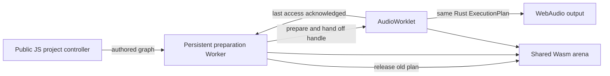

# Prepared Rust runtime on the browser audio thread

30 September 2026. Experimental change `wlkrkwqo`, parent `wplztvuu` (`b00903ae`). This is a working scheduling experiment; it is not completion of Main, host parity or the full port.

## Question and observed answer

Can a Worker prepare the ordinary authored graph while the AudioWorklet processes its Rust state directly, without requiring a normal-priority Worker to deliver each audio block?

**Yes for the bounded DspLiveScripting and FX slot-swap fixtures.** The [live experiment](https://wubulon.tailfac9f9.ts.net:4174/prepared-worklet-prototype.html) ran 24 authored edits per project with a second independent graph sounding. Four recordings contain no runs of 128 all-zero frames, and both graphs continue during a deliberate 250 ms stall of the preparation Worker. The Rust allocator instrumentation records zero allocation/reallocation and zero deallocation in these exercised `process()` callbacks, including compatible history transfer. A separate negative control intentionally allocates and frees one Box inside a callback and observes exactly one allocation and one deallocation. These results support this execution direction; they do not establish sustained deadline reliability.

The prior asynchronous Worker path still has a [retained deadline failure](browser-worker-ownership.md). Its production ownership fix remains in place. The new experiment has no four-block Worker bridge, and does not add latency to conceal that failure.

## Ownership and execution



Each host owns a shared Wasm memory and exactly two initialized Wasm instances: one audio instance and one compiler instance. Both are initialized before live editing begins. Each receives separately allocated TLS and a separate 1 MiB stack; neither reuses the other agent's Rust stack. A single persistent Worker serializes graph construction/resource preparation and retirement. No module instantiation or graph construction occurs on the audio thread during replacements.

The experimental `prepared-worklet` Cargo feature adds an explicit engine handle ABI. The existing `ENGINE` slot remains the preparation entry point in the Worker. `manifold_prepared_take` moves that prepared engine into a handle and empties the slot. Audio processing uses the handle directly rather than another instance's thread-local slot. Both the ordinary ABI and the handle ABI call the **same `process_engine` helper and Rust ExecutionPlan**; no DSP algorithm or project-specific signal path was added.

After the Worker returns from preparation and posts the handle, it does not touch that engine until explicit retirement. The AudioWorklet creates views in its message handler, takes the candidate at a block boundary, transfers the existing bounded Gain/Widener histories, and acknowledges the previous handle only after its last access. The Worker releases the previous engine after that acknowledgement, outside the callback. Independent engines occupy distinct owned regions of the same arena. The measured arenas stay at 16 MiB each. This page-count observation is not a proof of zero leaked bytes or a long-run allocator bound.

Wasm shared memory requires the special artifact built with atomics, imported shared memory and rebuilt Rust standard library. The build script uses the installed nightly toolchain, `rustc 1.98.0-nightly (f28ac764c 2026-06-23)`; the normal Wasm/library artifact and native hosts do not enable this feature. Headers isolate both the review document and its compiler Worker. This is an internal experiment, not a published execution mode or a stable raw-pointer ABI. Handle calls require valid, live, exclusively owned engine pointers in the same memory. TLS/stack storage lasts for the arena's lifetime.

## Actual project behavior and results

The page imports the public package controller and save APIs. Existing packaged DspLiveScripting and FX slot-swap author modules decide topology. The experimental host supplies preparation, publication and parameter acknowledgement. Host gain 0.375 is adopted by the controller and survives all edits and saved state. Projects are not reconstructed with a separate signal implementation.

The measured recipe is 48 kHz, 128-frame blocks, sine 220 Hz at 0.08, two instances, one-second warmup, 24 edits, 100 ms between edits, 12 ms caller work per edit, invalid-input rejection, an injected compiler cycle rejection followed by a valid replacement, a 250 ms compiler stall, and a final 750 ms observation. Automated audio used a verified disposable private null sink. Each completed case was measured once with the corrected reporting code.

| Project | Recorded frames per graph | Recording length | Script edit p95 / max | Compatible histories on final replacement | Rust callback allocs / frees |
| --- | ---: | ---: | ---: | ---: | ---: |
| DspLiveScripting | 183,808 | 3.829 s | 18.76 / 23.92 ms | 2 | 0 / 0 |
| FX slot swap | 193,024 | 4.021 s | 28.73 / 28.90 ms | 10 | 0 / 0 |

Both outputs in both cases have zero recorded silence runs of at least 128 frames and zero Rust processing failures. Each stall lasts at least 250 ms while both graphs advance 92 blocks. Both cases retain gain 0.375, recover from the actual Rust compiler rejection and leave no compiler Worker targets after close. Allocation counters belong to the audio Wasm instance's import hook, so preparation-thread allocation is not counted as callback allocation. These counters do not measure JavaScript allocation, locks or callback CPU microseconds.

The [raw report](evidence/2026-09-30-prepared-audio-thread-v2.json), four WAVs, two packages and [page captures](evidence/2026-09-30-prepared-audio-thread-v2-dsp-live-scripting.png) are retained. All nine measured source/package/Wasm hashes have exact copies under `web/public/prepared-worklet-prototype/2026-09-30-prepared-audio-thread-v2/measured-source/`. Two close-during-preparation/publication guards were added afterward; they are not exercised by this measurement. Normal Rust workspace tests pass (481), normal Wasm builds, web tests pass (56), feature checking and the production web build pass.

The [deliverable probe](evidence/2026-09-30-prepared-worklet-deliverables.json) loads all four WAV metadata without autoplay and imports both saved packages into the ordinary public browser host. It checks complete graph equality, sounding output and gain 0.375. The [retained review capture](evidence/prepared-worklet-retained-review.png) presents the playable artifacts.

## Failed and corrected measurements are preserved

- `2026-09-30-audio-thread/` failed browser setup. `2026-09-30-audio-thread-diagnostic/` identifies the stage as compiler Worker initialization. Setup succeeded after adding isolation headers to that Worker asset. The logs did not identify the browser's underlying empty Worker error, so the exact browser error cause is not claimed.
- `2026-09-30-prepared-audio-thread/` retains a DSP recording and summary from a verifier that incorrectly required a Rust rejection where JS preflight had already rejected the invalid constructor. Its timing field also overwrote end-to-end script latency with the shorter internal host duration. **Do not use its reported latency as end-to-end latency.** Snapshot `6162d352` retains that source/artifact state. The corrected job has its own immutable `-v2` label, measures the full caller workload and includes an actual Rust preparation rejection.
- Existing asynchronous Worker failures and the earlier ownership correction remain visible in their separate review. This experiment does not retroactively validate those recordings.

The new and old runs have different process/scheduling conditions, and the new recipe adds failure/stall probes. They are not a matched speed benchmark or a C++ comparison. No C++ versus native Rust versus browser full-project comparison was added here.

## Next implementation and open gates

1. Fold the validated explicit ownership boundary into the importable browser host behind a defined execution capability. Keep compilation and resource preparation off the audio thread, one authoritative accepted project, and failure preserving current audio. Specify publication, cancellation, retirement and idle/suspended behavior before promoting the experiment.
2. Implement prepared stable-path identity maps, actual Rust parameter readback and publication-time automation inheritance. The prototype transfers same numeric IDs for the bounded Gain/Widener histories and caches acknowledged submitted parameters; it does not yet provide the complete public host contract. Route commands, timed MIDI, samples and capture are deliberately rejected here.
3. Prove resource continuity for held notes, loops/captures and delay/reverb tails. Cross-instance resources need explicit ownership and retirement. Do not copy entire large buffers inside `process()` or silently reset their state.
4. Measure longer live editing, allocation retention, process failures, close during preparation/publication, multiple instances and callback CPU/GC/device deadlines. The guarded prototype still has incomplete startup/timeout/cancellation cleanup. The short PCM/allocator evidence is not a release safety bound.
5. Continue Main M1–M5, the legacy project inventory, shared egui presentation and native/VST3/CLAP package behavior through the same authored graph contract. Complete matching legacy C++/Rust/Wasm behavior and performance workloads. None of those full-port gates is closed by this experiment.

Reproduce with a fresh measurement destination:

```sh
bash scripts/build-prepared-worklet-prototype.sh
npm --prefix web run build
MANIFOLD_PREPARED_PROOF_LABEL=your-fresh-label \
  python scripts/with-private-null-audio.py node scripts/verify-prepared-worklet-prototype.mjs
python scripts/with-private-null-audio.py node scripts/verify-prepared-worklet-deliverables.mjs
```

The verifier rejects a nonempty destination and saves PCM/results before judging them. The live archive names the retained corrected job; a new job does not overwrite it. Listening is manual and one player can play at a time.
